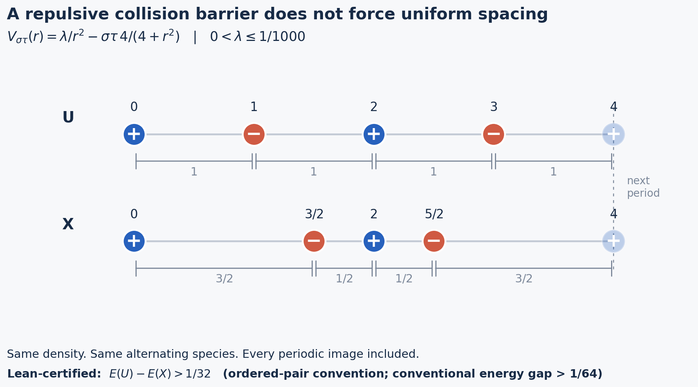

# 交替粒子链的 Cauchy 势扩展与 Lean 验证

**沿用已有四点反例构型，给出全对逆平方排斥核的显式容许区间与完整 Lean 4 证明。**

日期：2026-11-26（Australia/Sydney）。这是已有反例思路的定量扩展与形式化研究，不主张“全网原创”、首次发现该物理机制，或首次解决另一个已发表的开放猜想。

**原创性核查：** 四点几何来自视频对应的 Gaussian 反例项目；带全对奇异排斥核的非等间距最优性现象，在 Bétermin–Knüpfer–Nolte (2020) 的式 (2.4) 与定理 2.8 中已有不同势函数的先例。本次检索未找到与本项目完全相同的 Cauchy 势、参数界及 Lean 证书，但这不能确立全球优先权。完整的贡献对照与检索范围见 [NOVELTY.md](NOVELTY.md)。

English scope: **A Lean-verified quantitative Cauchy-kernel extension of an existing four-site alternating-chain counterexample.** The geometry is credited to the cited Gaussian construction. The explicit all-pair core, rational bounds, and formal proof are the contribution of this artifact; worldwide firstness is not claimed.

## 1. 结论

考虑两种粒子沿一维直线交替排列，物种标签为 `+1,-1,+1,-1,…`。标签不是普通电荷；本模型的有界相互作用是同种吸引、异种排斥。

两粒子间的势能定义为

$$
V_{\sigma\tau}(r)=\frac{\lambda}{r^2}-\sigma\tau\frac4{4+r^2},\qquad r\ne0.
$$

第一项对所有物种配对都排斥，而且任何正的 `λ` 都使势能在 `r→0+` 时趋于正无穷。第二项为有界的 Cauchy 型相互作用。

每个周期长为四，比较

$$
U=(0,1,2,3),\qquad X=(0,3/2,2,5/2),
$$

并将两者沿整条实轴无限重复。两者密度均为一、每周期两种粒子各两个、顺序相同。`X` 的四个间距（包括跨周期间距）为 `(3/2,1/2,1/2,3/2)`，没有粒子重合。

Lean 验证了以下对连续参数范围成立的严格结论：

$$
0\le\lambda\le\frac1{1000}
\quad\Longrightarrow\quad
E_\lambda(U)-E_\lambda(X)>\frac1{32}.
$$

为了确实具有碰撞排斥屏障，应取 `0<λ≤1/1000`；特别地，`λ=1/1000` 给出一个不以额外未证明命题为前提的闭合反例定理。

**因此，仅仅具有对所有粒子生效的奇异排斥核，并不足以保证等间距排列是能量最低的排列。**



## 2. 完整物理能量与归一化

设四个基元坐标为 `x_i`、物种标签为 `σ_i=(-1)^i`，采用参考论文的有序配对平均约定：

$$
E_\lambda(x)=\frac14\sum_{i=0}^{3}\sum_{j=0}^{3}
\sum_{m\in\mathbb Z}^{\prime}
\left[\frac{\lambda}{(x_j+4m-x_i)^2}
-\sigma_i\sigma_j\frac4{4+(x_j+4m-x_i)^2}\right].
$$

撇号只去掉 `i=j,m=0` 的中心自相互作用。相同粒子标签在其他周期中的所有镜像仍然保留。证明包含了每个镜像级数的绝对收敛性、距离分组重排的正确性，以及坐标式与用于估计的壳层级数之间的严格等式。

这里没有另除以二：每个无序配对按两个方向计数。若采用通常再除以二的每粒子总势能，所有能量及差值都减半，严格下界变为 `1/64`；排列优劣不变。

`Main.lean` 中的 `directEnergy` 就是上述单个合成势能的完整坐标求和式。`physicalEnergy` 是将两种相互作用分开求和的等价式，`totalEnergy` 是进一步化成距离壳层之后的等价式。三者的等价关系均有定理证明，不是未经核验的说明文字。

## 3. 如何找到并证明反例

### 3.1 按距离逐项数清配对

两种具体构型都在半整数网格上。物理距离 `n/2` 对应正整数 `n`。周期长度四对应八个半格点，因此每一层的配对数只依赖 `n mod 8`。

| `n mod 8` | 0 | 1 | 2 | 3 | 4 | 5 | 6 | 7 |
|---|---:|---:|---:|---:|---:|---:|---:|---:|
| U 带物种符号计数 | 8 | 0 | -8 | 0 | 8 | 0 | -8 | 0 |
| X 带物种符号计数 | 8 | -4 | 2 | -4 | 4 | -4 | 2 | -4 |
| U 无符号计数 | 8 | 0 | 8 | 0 | 8 | 0 | 8 | 0 |
| X 无符号计数 | 8 | 4 | 2 | 4 | 4 | 4 | 2 | 4 |

这些计数由 Lean 对实际坐标定义验证。还证明了每个符合余数条件的位移对应唯一的整数周期镜像。

### 3.2 Cauchy 相互作用降低多少能量

半格点上的相互作用是 `16/(16+n²)`。两构型的有界相互作用能量差为

$$
\Delta_C=\sum_{n=1}^{\infty}d_n\frac{16}{16+n^2},
$$

其中 `d_n` 以八为周期，按 `n=1,…,8` 排列为

$$
(-1,5/2,-1,-1,-1,5/2,-1,0).
$$

令 `B(m)` 为从 `n=8m+1` 到 `8m+8` 的八项和。首块可以精确计算：

$$
B(0)=\frac{23403}{453050}>\frac{103}{2000}.
$$

对每个实数 `x≥1`，`PolynomialCertificate.lean` 验证了

$$
B(x)+\frac1{800x^2}=\frac{P(x-1)}{D(x)}\ge0.
$$

`P` 是文件中明确给出的十四次整系数多项式，十五个系数全为正；`D(x)` 在 `x≥1` 时为正。这个恒等式由 Lean 的代数策略生成证明项并由内核检查。它不是只在若干整数点取样的数值检验。

再用已经证明的

$$
\sum_{m=1}^{\infty}\frac1{m^2}\le2,
$$

得到所有剩余块的总贡献不小于 `-1/400`。因此

$$
\Delta_C>\frac{103}{2000}-\frac1{400}=\frac{49}{1000}.
$$

代码显式证明了原级数与八项分块级数都收敛，并通过自然数与“块编号 × 块内位置”的双射证明重排等式。

### 3.3 排斥核最多付出多少代价

记 `C(p)` 为构型 `p` 的全粒子逆平方排斥能量。半格点距离引入的四倍系数与每周期四粒子的平均系数抵消，所以

$$
C(X)=\sum_{n=1}^{\infty}\frac{a_n}{n^2},\qquad 0\le a_n\le8.
$$

于是 `0≤C(X)≤16`，而 `C(U)≥0`。合成势能满足

$$
\begin{aligned}
E_\lambda(U)-E_\lambda(X)
&=\Delta_C+\lambda(C(U)-C(X))\\
&>\frac{49}{1000}-16\lambda\\
&\ge\frac{33}{1000}>\frac1{32}.
\end{aligned}
$$

逆平方级数上界也有独立的初等证明：逐项用 `1/x²≤2/x−2/(x+1)`，将有限部分和望远镜相消，再证明其收敛并取得无限和上界。

### 3.4 排斥屏障并非口头假设

对所有正 `λ`、`|s|≤1` 和 `B≥0`，Lean 验证

$$
\exists \delta > 0,\quad \forall r\in(0,\delta),\quad
B < \frac{\lambda}{r^2}-s\frac{4}{4+r^2}.
$$

所以任意高的目标配对势能都可在足够近的距离处超过。这确切表达了正方向趋近碰撞时势能趋于正无穷。它是配对碰撞屏障的结论，不单独等同于无限体系整体的热力学稳定性定理。

## 4. 数值直观与严格结论的区别

以下只是高精度数值直观，不用于 Lean 证明：

| 数量 | 近似值 |
|---|---:|
| Cauchy 部分的能量优势 `Δ_C` | 0.050450792503 |
| 排斥核能量增量 `C(X)-C(U)` | 2.775826237806 |
| `λ=1/1000` 时的净能量优势 | 0.047674966265 |
| Lean 已认证的简单严格下界 | 1/32 = 0.03125 |

`numerical_check.py` 使用 Python 标准库，独立枚举实际坐标的有限周期镜像并与壳层求和核对，用有理数核对首块和整个多项式恒等式，并输出较大截断范围的浮点近似。它可以发现实现错误，但不承担无限级数证明。

## 5. Lean 文件与主定理

| 文件 | 职责 |
|---|---|
| `ChainModel.lean` | 实际坐标、物种、全部周期镜像、配对计数、无自碰撞、重排与坐标公式 |
| `CoreBounds.lean` | 逆平方级数收敛和上界、实际排斥核界、碰撞屏障 |
| `PolynomialCertificate.lean` | 首块精确值、十四次多项式恒等式、所有尾块的统一界 |
| `CauchyCertificate.lean` | Cauchy 级数收敛、合法八项分块、完整无限和的严格下界 |
| `Main.lean` | 将证书连接到物理势能，连续参数区间定理与明确反例 |

最值得检查的定理：

```lean
VerifiedChain.direct_counterexample
VerifiedChain.repulsive_core_counterexample
VerifiedChain.pairPotential_collision_barrier
```

其中闭合主定理的内容为：

```lean
theorem repulsive_core_counterexample :
    (1/32 : ℝ) < directEnergy (1/1000) uniform
                   - directEnergy (1/1000) shifted
```

证明不依赖 `sorry`、`admit`、自定义公理、`native_decide`、不安全求值或外部数值求解器返回的可信结论。关键定理的公理依赖是 Lean/mathlib 通常的 `propext`、`Classical.choice`、`Quot.sound`。完整编译、逐一定理依赖和官方 `leanchecker` 重放记录见 `verification/`。

## 6. 复现

固定工具链为 **Lean 4.28.0**，mathlib 固定提交为

```text
8f9d9cff6bd728b17a24e163c9402775d9e6a365
```

工程不依赖视频仓库的 Lean 文件，也不需要从该仓库导入任何定理。`lake-manifest.json` 固定 mathlib 及其依赖版本。

安装 Lean 的官方工具链管理器 elan 后，在此目录执行：

```bash
python3 verify.py
```

脚本下载当前工程需要的官方 mathlib 缓存，构建所有五个源模块，打印主定理公理依赖，调用官方 `leanchecker` 重新检查本工程的声明，最后运行独立数值核对。它不会把数值核对结果当作 Lean 的公理。

也可以手动执行：

```bash
lake exe cache get
lake build
lake env lean Main.lean
for module in ChainModel CoreBounds PolynomialCertificate CauchyCertificate Main; do
  lake env leanchecker --verbose "$module" || exit 1
done
python3 numerical_check.py
```

`leanchecker` 使用同一个 Lean 内核重放声明，用于检查编译产物；它不是另一个独立实现的证明系统。逐个模块执行可降低内存峰值。通常无需重新编译 mathlib 本身。PNG 插图不参与证明，重新生成它需安装 matplotlib 并执行 `python3 make_figure.py`。

`verification/summary.json` 是随项目提供的历史验证记录，保留其原始时间与源文件哈希。再次运行 `verify.py` 会生成新的日志，但不会自动改写这份历史摘要；新的验证应以新生成日志及命令退出状态为准。

## 7. 结论边界

- 这是本次明确选定的模型问题及其反例。没有凭一次检索断言文献首创，也没有把它称作第二个已发表开放猜想的首次解决。
- 已证明等间距构型不是全局最优；没有证明 `X` 就是真正基态，也没有证明等间距链对任意小位移局部不稳定或真实动力学不稳定。
- `0<λ≤1/1000` 是已经认证的充分范围，不是最大允许范围、精确相变边界或所有密度下的结论。
- 模型使用明确指定的物种标签、势函数和无量纲长度。Lean 验证的是这些数学定义之下的定理，不替代真实材料的实验验证。

## 8. 视频、文献与方法来源

用户提供的视频：[Bilibili BV1ZsyrzGEL6](https://www.bilibili.com/video/BV1ZsyrzGEL6/)。本次读取了简介链接的代码和手稿，并核对了原始论文；没有拿到逐字字幕，故不对视频全部画面作断言。

视频仓库：[xiujiang4/alternating-particle-chains](https://github.com/xiujiang4/alternating-particle-chains)，核查版本为 `a48fe4c2623a29dd45edd227410a07baba400250`。该仓库用高斯势与同样的两个四粒子周期构型反驳原文的猜想 2.7，并区分了已形式化与未形式化的结论。

原始论文：Laurent Bétermin, Hans Knüpfer, Florian Nolte, *Note on Crystallization for Alternating Particle Chains*, Journal of Statistical Physics 181, 803–815 (2020), DOI [10.1007/s10955-020-02603-2](https://doi.org/10.1007/s10955-020-02603-2)。[开放全文](https://pmc.ncbi.nlm.nih.gov/articles/PMC7547999/)。

这篇原始论文的式 (2.4) 与定理 2.8 也给出了另一类全对奇异排斥核心模型的低密度非等间距结论。其幂律核与长程符号结构不同，不能当作本项目精确 Cauchy 定理的已有证明；它确实表明上述宽泛物理现象已有先例。

相关文献：Laurent Bétermin, Ladislav Šamaj, Igor Travěnec, *Equidistant versus bipartite ground states for 1D classical fluids at fixed particle density*, Analysis and Mathematical Physics 15, 88 (2025), DOI [10.1007/s13324-025-01076-4](https://doi.org/10.1007/s13324-025-01076-4)。该文研究单组分 Lennard–Jones/Mie 势及硬核心扩展；它提供现象层面的背景，不是本项目同一模型的重复结果。

本次沿用“明确周期构型—计算能量差—严格控制无限尾项—形式化验证”的方法和反例几何。新的势函数改为 Cauchy 型，并加入对所有物种同号的排斥核，因此问题已区别于原文的 `(-f,-f,f)` 势函数类别。本工程独立实现了所需证明，只以固定版本的 mathlib 作为数学库依赖。

视频仓库手稿还明确讨论了向带符号的核函数中加入足够小的逆平方项。该项与本项目对所有粒子对同号的排斥核不同；然而“小扰动保留严格能量差”的基本原理不是本项目的新发现。将 Gaussian 核换为 Cauchy 核后，仍需另行证明能量差的符号；不能把具体 Cauchy 结论当作一个 Gaussian 反例的自动推论。

Lean 官方：[lean-lang.org](https://lean-lang.org/)；mathlib 固定源码：[指定提交](https://github.com/leanprover-community/mathlib4/tree/8f9d9cff6bd728b17a24e163c9402775d9e6a365)。
